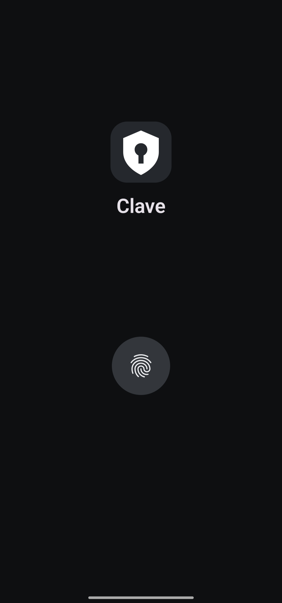
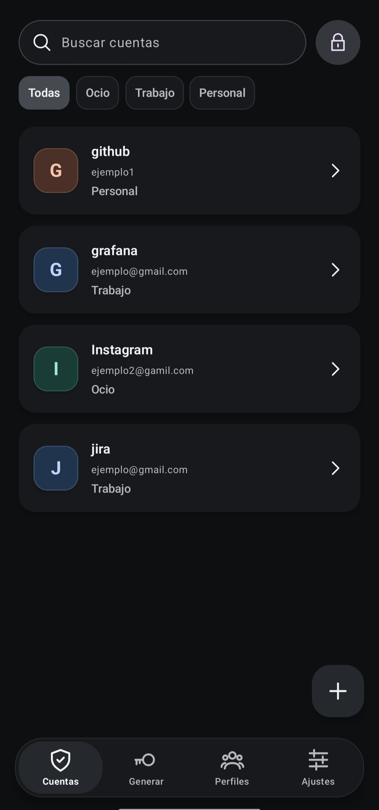
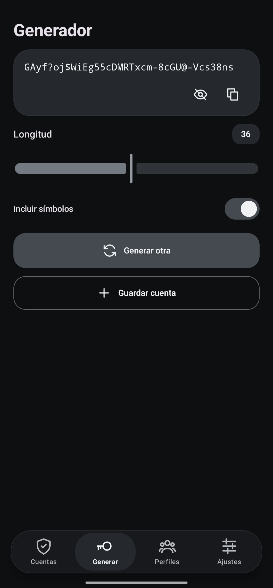
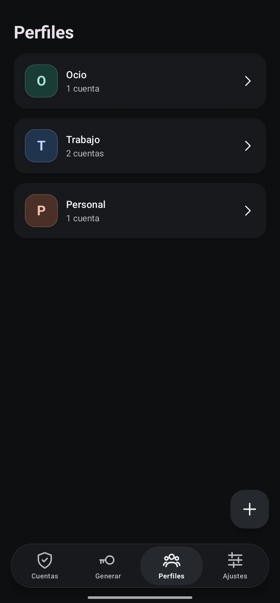
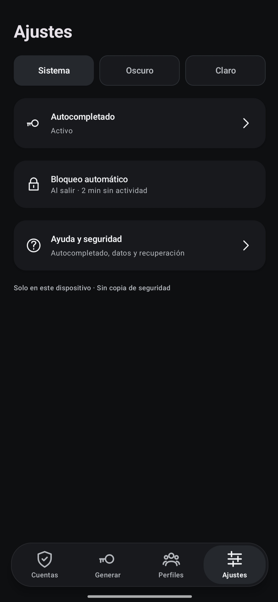

# Clave

Aplicación nativa de Android para gestionar contraseñas. Guarda las cuentas de forma local y permite generar contraseñas seguras y completar credenciales mediante Autofill.

## Funciones

- Desbloqueo con biometría.
- Gestión y búsqueda de cuentas por perfiles.
- Generador de contraseñas configurables.
- Autorrelleno de credenciales en aplicaciones y webs compatibles.
- Cifrado local con Android Keystore; no utiliza servidor ni sincronización en la nube.

## Capturas

<p align="center">
  
  
  
  
  
</p>

## Ejecutar el proyecto

Requiere Android 11 o superior, JDK 17 y Android SDK 36.

```sh
./build-apk.sh --check
./build-apk.sh
```

El APK se genera en `artifacts/clave.apk`. Para desarrollo, abre la carpeta `native/` con Android Studio y usa JDK 17.
